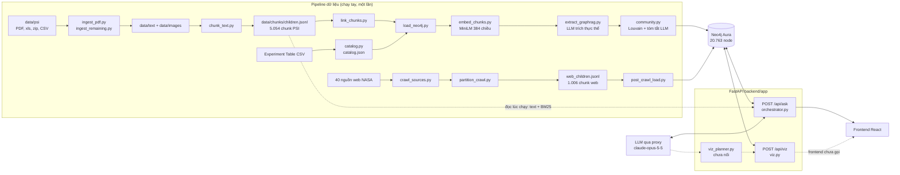
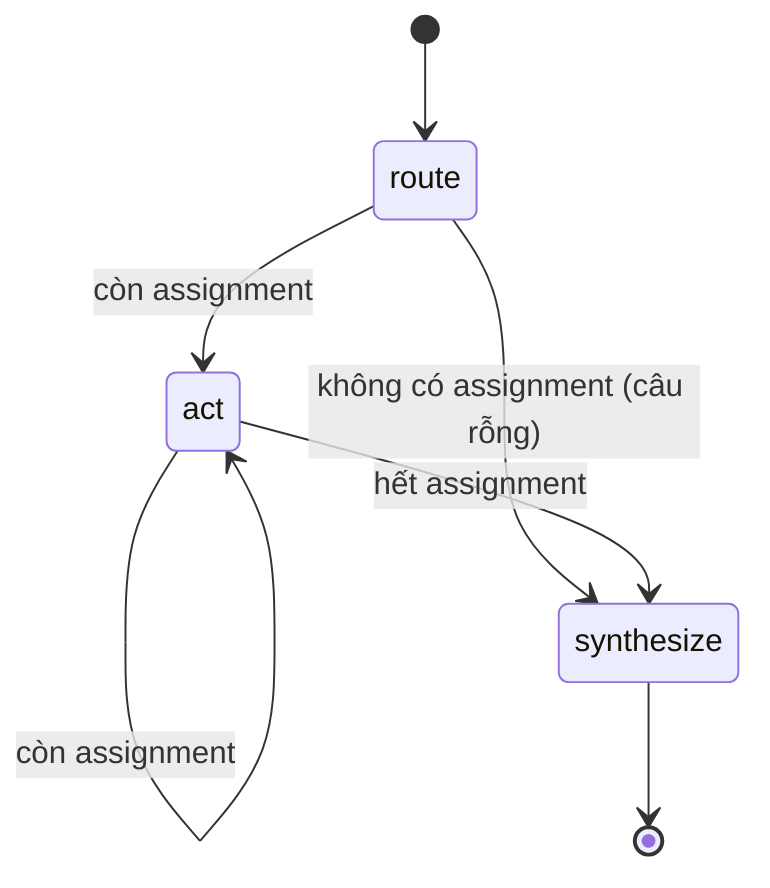
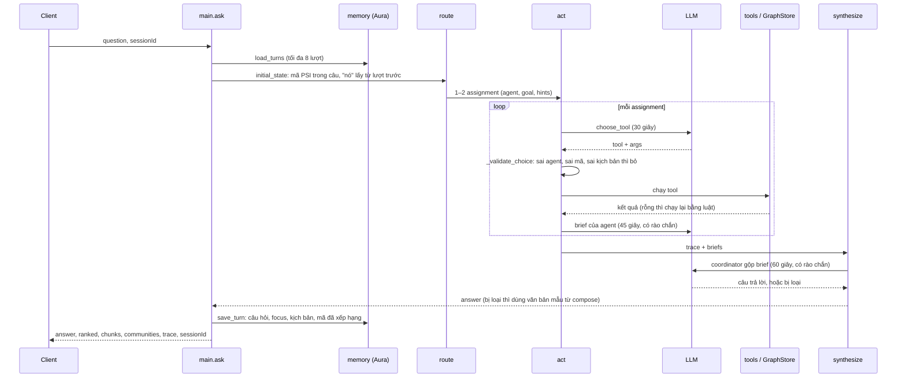
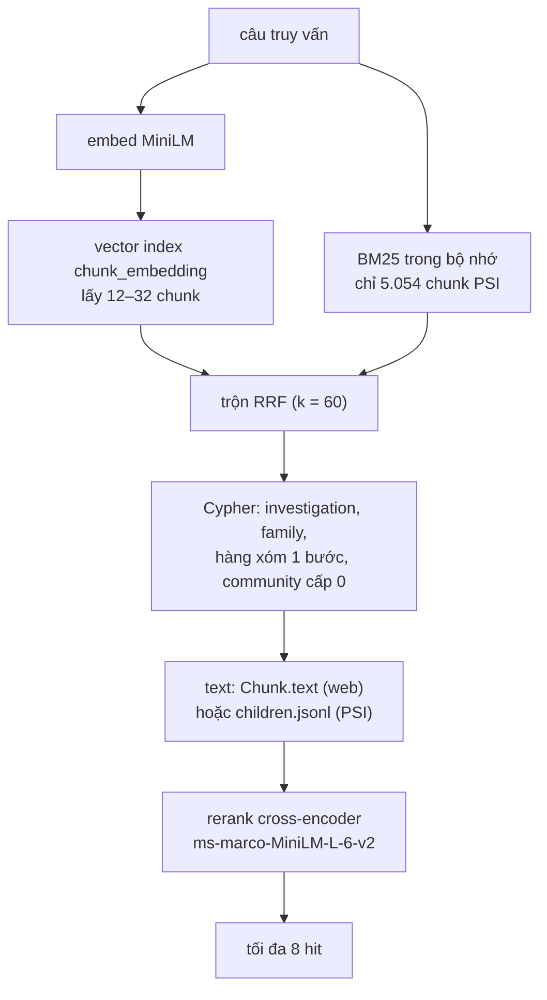
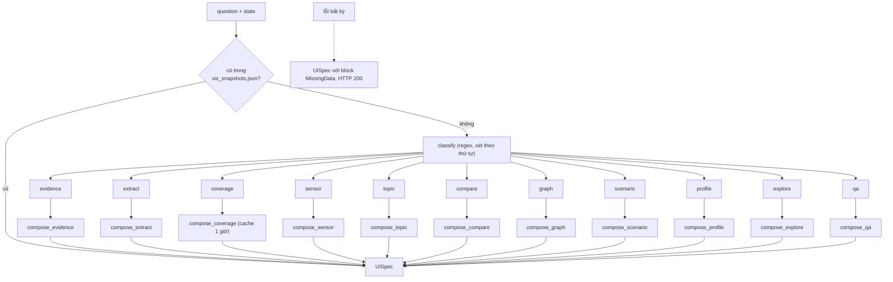
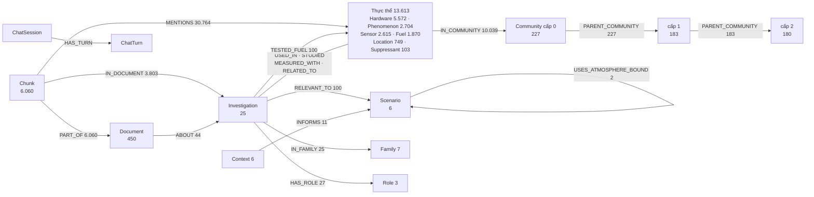

# AGENT_FLOW_STATUS — Luồng xử lý và hiện trạng Agent

| | |
|---|---|
| **Thời điểm đo** | 15/11/2026, 13:26–13:31 UTC, trên code đang nằm ở `/workspace` |
| **Phạm vi** | Agent (backend) và dữ liệu. Frontend chỉ ghi nhận, không đánh giá |
| **Cách đo** | Đọc code, chạy API từ code trên đĩa ở cổng tạm 8011, truy vấn chỉ-đọc vào Neo4j Aura, chạy bộ test |
| **Liên quan** | `docs/AGENT_VIZ_SPEC.md`, `docs/AGENT_GENUI.md` |

## 1. Kết luận

**Chưa hoàn chỉnh, nhưng phần lõi chạy được.**

| Hạng mục | Trạng thái | Ghi chú ngắn |
|---|---|---|
| Đồ thị điều phối (LangGraph) | Hoàn chỉnh theo thiết kế hiện tại | 3 node, mọi cạnh nối đủ, luôn kết thúc |
| Agent hỏi đáp `/api/ask` | Chạy được, chưa ổn định | 12/12 câu trả HTTP 200; 6,5–42 giây; 2/11 câu rơi về văn bản mẫu |
| Agent giao diện `/api/viz` | Một phần | Khung UISpec đúng 100%; theo bộ kiểm tra của tôi 78 mục đạt, 28 mục chưa |
| Planner theo ngữ cảnh | Có code và test, chưa nối vào endpoint | Xem `docs/AGENT_GENUI.md` |
| Đồ thị tri thức (Aura) | Dùng được, còn lỗ hổng chất lượng | 25% thực thể bị cô lập; 37% chunk chưa nối với investigation |
| Triển khai | Chưa | API ở cổng 8000 vẫn là bản 14/11, chưa có `/api/viz` |
| Bộ test | 104/104 | Trừ `test_pdf_captions.py` (thiếu `pymupdf` trong venv `nasa-api`) |

## 2. Bức tranh tổng



Ba phụ thuộc lúc chạy của API: Neo4j Aura, file `data/chunks/children.jsonl` trên đĩa, và LLM qua proxy.

## 3. Luồng `/api/ask`

### 3.1 Đồ thị LangGraph (lấy trực tiếp từ `compiled_graph().get_graph()`)



- 5 node: `__start__`, `route`, `act`, `synthesize`, `__end__`. 6 cạnh, trong đó 4 cạnh điều kiện đi qua cùng một hàm `dispatch`.
- Vòng lặp ở `act` luôn dừng: mỗi lần chạy lấy ra đúng một assignment, và `route` tạo tối đa 2 assignment.
- 5 agent chuyên trách **không phải node riêng**. Chúng là hàm được gọi lần lượt bên trong `act`.

### 3.2 Trình tự một câu hỏi



Mỗi câu hỏi tốn từ 3 đến 5 lần gọi LLM: mỗi assignment 2 lần (chọn tool, viết brief), cộng 1 lần tổng hợp.

### 3.3 Bảng định tuyến (`orchestrator.route`, thuần regex, xét từ trên xuống)

| Điều kiện | Assignment |
|---|---|
| Có từ so sánh và nêu từ 2 mã trở lên | `comparer(ids)` |
| Có từ so sánh, nêu dưới 2 mã | `ranker(kịch bản hoặc iss, 2)` → `comparer(lấy từ ranker)` |
| Nêu 1 mã và có từ về đồ thị (hardware, fuel, liên quan…) | `reader(id)` → `navigator(id)` |
| Nêu 1 mã, không hỏi xếp hạng | `reader(id)` |
| Nhận ra kịch bản hoặc có từ xếp hạng | `ranker(kịch bản hoặc iss, 5)` → `navigator(kịch bản)` |
| Có từ tổng quan (overview, theme, community…) | `graphrag(global)` |
| Còn lại | `graphrag(local)` → `graphrag(global)` |

### 3.4 Agent và tool

| Agent | Tool được phép | Việc làm |
|---|---|---|
| `ranker` | `rank_investigations` | Xếp hạng theo điểm `RELEVANT_TO` của kịch bản |
| `reader` | `get_investigation` | Đọc thẻ một investigation |
| `comparer` | `compare_investigations` | So 2–4 investigation theo oxy, dòng khí, nhiên liệu, vai trò, họ phần cứng |
| `navigator` | `graph_neighbors`, `scenario_context` | Đi các cạnh quanh investigation; lấy lịch sử gắn với kịch bản |
| `graphrag` | `local_search`, `global_search` | Tìm chunk; đọc tóm tắt community |

Tool `search_investigations` còn trong `SPECS` và `IMPLEMENTATIONS` nhưng không agent nào được gọi.

### 3.5 Tìm kiếm



`global_search`: đọc tối đa 800 community, rerank theo `title + summary + psiIds`, kèm khoảng oxy lấy từ thẻ investigation.

### 3.6 Rào chắn (`prompts.grounded_complete`)

- Lập danh sách cho phép từ bằng chứng: mã PSI, các con số phần trăm, mã community.
- Bản nháp nêu mã PSI hoặc phần trăm ngoài danh sách thì bị loại, LLM được viết lại **một lần**.
- Vẫn vi phạm, hoặc LLM lỗi hay trả rỗng, thì trả `None` và câu trả lời rơi về văn bản mẫu.

### 3.7 Bộ nhớ phiên (`memory.py`)

- Lưu ở Aura: `(:ChatSession)-[:HAS_TURN]->(:ChatTurn)`, giữ 8 lượt mới nhất. Aura lỗi thì lưu trong RAM.
- Chỉ lưu câu hỏi, kịch bản, mã focus, mã đã xếp hạng, mode. Không lưu câu trả lời.
- Hiện có 1 phiên với id `string` và 2 lượt, do ai đó thử qua Swagger.

## 4. Luồng `/api/viz`



- Không gọi LLM. Nhanh: 0,1–1,1 giây.
- Mỗi câu hỏi ra đúng một view.
- Planner (`viz_planner.compose_planned`) đứng trước bước `classify` để chọn 1–3 view theo ngữ cảnh. Đã có code và 15 test, **chưa nối** vào `main.py`.
- `/api/viz/profile` và `/api/viz/graph` đã được bọc `_viz_or_missing`, lỗi đồ thị không còn thành HTTP 500.

## 5. Đồ thị tri thức trong Aura

### 5.1 Schema và số lượng



Chỉ mục: 1 vector index `chunk_embedding` (ONLINE), 14 ràng buộc. Không có fulltext index.

### 5.2 Phần đã đủ

| Kiểm tra | Kết quả |
|---|---|
| Chunk có embedding | 6.060 / 6.060 |
| Chunk nằm trong một Document | 6.060 / 6.060 |
| Document có chunk và có title | 450 / 450 |
| Investigation có điểm cho cả 4 kịch bản có điểm | 25 / 25 (4 × 25 = 100 cạnh) |
| Investigation có family, role, hardware, chunk, hiện tượng | 25 / 25 mỗi loại |
| Community có title và summary | 590 / 590 |
| Kịch bản không có điểm riêng (mars, rover) | cả hai trỏ về `moon` qua `USES_ATMOSPHERE_BOUND` |

### 5.3 Phần còn thiếu hoặc yếu

| Vấn đề | Số liệu | Hệ quả |
|---|---|---|
| Thực thể cô lập (không có cạnh nào) | 3.390 / 13.613 (25%): Hardware 1.464, Sensor 631, Phenomenon 561, Fuel 498, Location 211, Suppressant 25 | Chiếm chỗ, không bao giờ xuất hiện trong kết quả |
| Thực thể không thuộc community nào | 3.607 | Không vào được tìm kiếm toàn cục |
| Node trùng nhãn (khác hoa/thường hoặc khác phạm vi `@PSI`) | 2.839 node | NodeGraph còn 8 nhãn trùng quanh PSI-102; "p trak" và "ptrak" chưa gộp |
| Chunk chưa nối với Investigation | 2.257 / 6.060 (37%): `ACME_common` 1.251, web 1.006 | Hồ sơ các thí nghiệm ACME không lấy được bằng chứng từ tài liệu chung |
| Chunk không có `MENTIONS` nào | 277 | Chỉ tìm được bằng vector hoặc BM25 |
| Text của chunk PSI không nằm trong Aura | 5.054 chunk, chỉ 1.006 chunk web có `Chunk.text` | API phải có `children.jsonl` trên đĩa |
| BM25 không gồm chunk web | 1.006 chunk | Chunk web chỉ tìm được bằng vector |
| Chiều quan hệ không nhất quán | `MEASURED_WITH` có 5 dạng (Phenomenon→Sensor 1.805, Investigation→Sensor 902, Sensor→Phenomenon 78, Sensor→Investigation 54, Phenomenon→Hardware 91); `USED_IN` đi cả hai chiều | Code truy vấn không xét chiều nên vẫn chạy, nhưng ý nghĩa cạnh không rõ |
| Phân cấp community gần như phẳng | 227 → 183 → 180 | Cấp 1 và cấp 2 gần như lặp lại cấp 0, khoan chủ đề ít giá trị |
| Community có `psiIds` | 29 / 590 | Hầu hết chủ đề không dẫn về investigation nào |
| Investigation thiếu trường | oxy 9/25, flow 6/25, measurements 11/25, sampleForm 11/25, runCount 20/25, `TESTED_FUEL` 18/25 | Gauge và bảng so sánh thường rỗng |
| Investigation không có cảm biến | PSI-60, PSI-115, PSI-142 | Vắng trong ma trận cảm biến |
| Investigation rất ít chunk | PSI-60, 62, 142: 1 chunk; PSI-98: 4; PSI-99: 5; PSI-100: 6 | Bằng chứng cho Saffire mỏng |
| Khoảng oxy không có trong chunk | CSV Experiment Table không được cắt chunk | Đã có `backend/var/viz_field_evidence.json` chỉ tới file, cột, dòng |

## 6. Bảng hoàn chỉnh theo chức năng

### 6.1 `/api/ask` (12 câu thử, code trên đĩa, 13:27 UTC)

| Khả năng | Kết quả |
|---|---|
| Xếp hạng theo kịch bản | Đạt, 39 giây |
| Đọc một investigation | Đạt, 12 giây |
| Hỏi nối tiếp ("its oxygen range?") | Đạt: trả đúng BASS-II 13,6–22,2%, 6,5 giây |
| So sánh hai investigation nêu tên | Đạt, 14 giây |
| Đi đồ thị (hardware, fuel của FLEX) | Đạt, 15 giây |
| Tìm chunk | Đạt, và nói rõ khi bằng chứng không trả lời được, 36 giây |
| Tổng quan chủ đề | Đạt, 17 giây |
| Chunk web (cháy trạm Mir 1997) | Đạt, 32 giây |
| Câu tiếng Việt | **Chưa**: 2/2 câu rơi về văn bản mẫu tiếng Anh |
| Câu lạc đề | Đạt lần này: từ chối. Lần chạy 12:27 UTC cùng code agent đã trả lời "Paris" |
| Câu rỗng | Đạt |
| Thời gian | 6,5–42,4 giây, trung vị khoảng 17 giây |

Kết quả giữa hai lần chạy khác nhau dù code agent không đổi. Nguyên nhân đã xác định: proxy LLM có lúc trả về text rỗng (`output_tokens: 0`) sau 0,2 giây, và `grounded_complete` coi rỗng là thất bại. Đường `/api/ask` chưa có thử lại cho trường hợp này.

### 6.2 `/api/viz` theo `AGENT_VIZ_SPEC.md` (code lúc 13:26 UTC)

| Chức năng | Mức | Đã có | Còn thiếu |
|---|---|---|---|
| Khung UISpec (mục 7) | Đạt | 12/12 spec đúng khung, chỉ dùng component trong catalog | |
| Định tuyến intent (mục 8) | Đạt | 11/11 intent trong bảng | Câu tiếng Anh có chữ "source" bị đẩy sang `evidence` |
| F1 Explorer | Một phần | 25 thẻ; lọc family ra 6/5/4/3/3/3/1; lọc fuel | `relevance` rỗng khi không có kịch bản; StatCard 1/4; lọc Location |
| F2 Hồ sơ | Gần đạt | Header đủ acronym/doi/sources; 4 StatCard; GaugeO2 có evidence; dưới 1 giây | ChipList hardware; 1/3 chunk bằng chứng của PSI-99 thuộc PSI-100 |
| F3 So sánh | Một phần | 3 hồ sơ, không lỗi khi thiếu oxy | 4/8 hàng; ô thiếu không có cờ missing |
| F4 NodeGraph | Một phần | ≤ 60 node; `depth=2` thật; mở được từ thực thể; nhãn sạch; 0,3 giây | PSI-102 không có node hiện tượng; `weight` luôn 1; 8 nhãn trùng; không evidence |
| F5 Chủ đề | Gần đạt | Khoan 2 → 1 → 0; breadcrumb; có `psiIds` | Chunk tiêu biểu khi chọn community |
| F6 Cross-filter | Một phần | Backend nhận và trả lại bộ lọc family, fuel | State Store phía client |
| F7 Coverage | Đạt | 43 nguồn đúng số; heatmap chuẩn hoá có caption; 6 nhóm trường; có cache | |
| F8 CSV | Một phần | 25 dòng; ô trống để trống; cảnh báo cột phủ dưới 50% | Dòng đầu là `# warning`, không phải header; thiếu cột mã PSI |
| F9 Cảm biến | Một phần | Ma trận; nhãn sạch; ChipList chất dập cháy và extinction | PSI-47 ra 31/31 (spec ghi 45/43 theo `MENTIONS`); chưa có chunk bằng chứng |
| F10 Bằng chứng | Một phần | ≤ 5 chunk; đủ trường; `documentTitle` đúng là `Document.title` | Không chunk nào chứa 21,5/22,1 (giới hạn dữ liệu) |
| F11 Briefing | Một phần | Đúng thứ tự điểm; đủ 6 kịch bản; có ghi chú lịch sử | Rủi ro cháy, cảm biến khuyến nghị, khoảng trống dữ liệu, evidence |
| F12 Hỏi đáp | Đạt khung | ≤ 120 từ; EvidencePanel; 3 chip | `text` là trích đoạn ghép, không phải câu trả lời |
| Snapshot demo | Chưa | Có cơ chế và test | Chưa có file `viz_snapshots.json` |
| Truy vết (nguyên tắc 3) | Một phần | profile 6/8 block có evidence; topic, coverage, extract, sensor đủ | explore 0/26; compare, graph 0/1; scenario 0/6 |
| Giới hạn cứng (mục 4) | Chưa kiểm | `graph.py` đã khai báo `QUERY_TIMEOUT_SECONDS = 10.0` và các hằng LIMIT | Chưa thử tình huống truy vấn quá giờ |

### 6.3 Đồ thị điều phối: đủ và chưa đủ

Đủ: mọi nhánh của `route` đều dẫn tới `synthesize`; tool rỗng có đường lùi về luật; LLM lỗi có đường lùi về văn bản mẫu; `test_agents.py` phủ các nhánh này.

Chưa có hoặc hạn chế:

- Các agent chạy tuần tự trong một node, không song song, nên thời gian cộng dồn.
- Đồ thị được dựng lại ở mỗi request (`compiled_graph(store)` gọi `build_graph`).
- Không có checkpointer của LangGraph; bộ nhớ nằm ngoài đồ thị.
- Không có node thử lại hay tự kiểm. Rào chắn chỉ cho viết lại một lần.
- Nêu từ 2 mã mà không có từ so sánh thì không vào `reader` hay `comparer`, rơi về tìm kiếm.
- Trường `wants_graph` và `plan` trong state không ảnh hưởng tới điều phối.
- Câu chạy cả `local_search` và `global_search` được gắn `mode = "global"`.
- `/api/viz` và planner nằm ngoài đồ thị này.

## 7. Việc còn lại, xếp theo mức ảnh hưởng

1. **Restart API cổng 8000** để bản mới có hiệu lực (`~/start-api.sh`). Hiện người dùng vẫn chạy bản 14/11.
2. **Thử lại khi LLM trả rỗng** trong `grounded_complete` và `choose_tool`. Đây là nguyên nhân chính khiến câu trả lời rơi về văn bản mẫu và kết quả thất thường.
3. **Nối planner** vào `POST /api/viz` (6 dòng, mục 7 của `AGENT_GENUI.md`) và tạo `viz_snapshots.json`.
4. **Nối `ACME_common` và chunk web với Investigation** (cạnh `IN_DOCUMENT` theo `psi_ids`), để hồ sơ có đủ bằng chứng.
5. **Gộp thực thể trùng và xoá thực thể cô lập** (3.390 node), chuẩn hoá chiều `MEASURED_WITH` và `USED_IN`.
6. **Đưa text của chunk PSI lên `Chunk.text`** và thêm fulltext index, để bỏ phụ thuộc vào `children.jsonl` và để BM25 gồm cả chunk web.
7. **Hoàn thiện view còn thiếu**: F3 (8 hàng), F4 (trọng số, node hiện tượng), F8 (header CSV, cột mã PSI), F11 (rủi ro, cảm biến).
8. **Chạy agent song song** trong `act` khi có 2 assignment độc lập, để giảm thời gian chờ.

## 8. Cách đo lại

```text
# test tự động
~/venvs/nasa-api/bin/python -m pytest -q --ignore=backend/tests/test_pdf_captions.py

# chạy bản trên đĩa ở cổng phụ, không đụng cổng 8000
~/venvs/nasa-api/bin/uvicorn app.main:app --app-dir backend --host 127.0.0.1 --port 8011

# cấu trúc LangGraph
python -c "from app.orchestrator import compiled_graph; from app.graph import open_store; print(compiled_graph(open_store()).get_graph().draw_mermaid())"

# nguồn của khoảng oxy
~/venvs/nasa-api/bin/python backend/scripts/build_field_evidence.py --check
```

Các con số ở mục 5 và 6 là ảnh chụp lúc 13:26–13:31 UTC ngày 15/11/2026. `viz.py`, `main.py` và `graph.py` đang được sửa liên tục trong ngày, nên bảng 6.2 cần đo lại sau mỗi đợt sửa.
